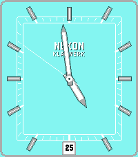
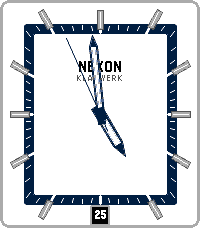
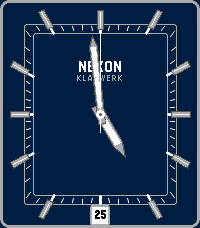
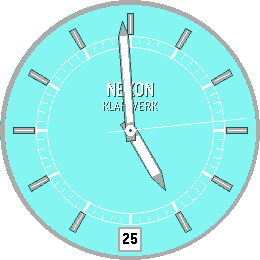
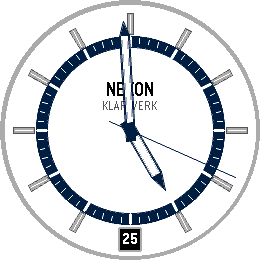
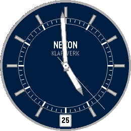

# Nexon

*A cushion-shaped analogue dial in the spirit of 1970s German watchmaking.*

  

  

A Pebble watchface (v1.0.0) for Pebble Time 2 (emery) and Pebble Round 2 (gabbro): applied baton indices, an inner minute track, the fictional maker's mark "Nexon Klarwerk" and a date window at six.

On emery the minute track and indices follow the rectangular screen; on gabbro they are round and the hands are longer.

## Settings

- **Colour** - turquoise, white with a navy minute ring, or navy.
- **Second hand** - on or off. Off means one redraw per minute.

## Building

Requires the [Pebble SDK](https://developer.repebble.com/sdk/).

```bash
pebble build
pebble install --emulator gabbro
```

## Release notes

### 1.0.0

First release with three dial colours and an optional second hand.

## Status

- Done for emery and gabbro, not published yet.
- All geometry runs through `polar()` / `rect_r()` in `src/c/nexon.c`; on gabbro `rect_r()` returns a constant radius, which turns the squares into circles.
- Colour schemes live in `schemes_init()`. The turquoise uses `GColorCyan`, which the panel renders lighter (about 132/245/241) than a real turquoise dial; `GColorTiffanyBlue` was tried and looked dull.
- Open: no port to the older platforms.

## License

MIT, see [LICENSE](LICENSE).
